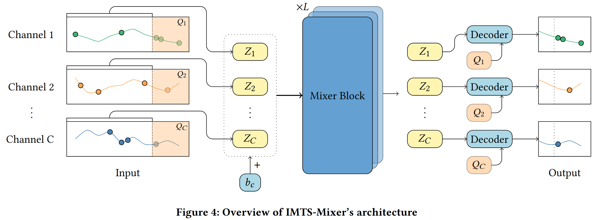

# IMTS Mixer
This is the official implementation of "IMTS-Mixer: Mixer-Networks for Irregular Multivariate Time Series Forecasting" submitted to SIGKDD 2025 




# Datasets
Our experiments follow [1], and we reused raw data and preprocessing code as published in this repository:
https://github.com/usail-hkust/t-PatchGNN.

The datasets Activity and USHCN are provided within this repo and can be used out-of-the-box, while
PhysioNet will be automatically downloaded and preprocessed, when running the code with the respecitve dataset for the first time.

The MIMIC dataset is under the PhysioNet Credentialed Health Data License, which is why it cannot be included in the repo. Please follow the instructions provided here: https://github.com/usail-hkust/t-PatchGNN in order to obtain the MIMIC dataset.

# Requirements
To run the code, we recommend creating a fresh environment. For our experiments we used Python 3.11
```bat
conda create -n imtsmixer python==3.11 
```
```bat
conda activate imtsmixer
```
```bat
pip install -r requirements.txt
```
# Run IMTS Mixer
To run IMTS mixer on the respective datasets you can simply execute run_imts_mixer.py

You can select the --dataset from physionet, mimic, activity and ushcn.
To reproduce our experiments you have to select --history 24 for ushcn (24 months), physionet(24 h) and mimic (24 h) and --history 3000 for activity (3000 ms).
For example, you can run


```bat
cd IMTSMixer
```
```bat
python run_imts_mixer.py  --D 256 --Dout 128 --mixer-blocks 3 --dataset activity --history 3000
```
# GraFITi

We also adapted the code of GraFITi[2] so it can be run on the benchmark. 
GraFITi can be run on Activity by:
```bat
cd GraFITi
```
```bat
python run_grafiti.py --dataset activity --history 3000
```
We do not provide code to run tPatchGNN[1] as this can be done completely based on the code 
shared here: https://github.com/usail-hkust/t-PatchGNN.

# References
[1]Weijia Zhang, Chenlong Yin, Hao Liu, Xiaofang Zhou, and Hui Xiong. 2024.
Irregular Multivariate Time Series Forecasting: A Transformable Patching Graph
Neural Networks Approach. In Forty-First International Conference on Machine
Learning.

[2]Vijaya Krishna Yalavarthi, Kiran Madhusudhanan, Randolf Scholz, Nourhan
Ahmed, Johannes Burchert, Shayan Jawed, Stefan Born, and Lars Schmidt-Thieme.
2024. GraFITi: Graphs for Forecasting Irregularly Sampled Time Series. Pro-
ceedings of the AAAI Conference on Artificial Intelligence 38, 15 (March 2024),
16255–16263. doi:10.1609/aaai.v38i15.29560
