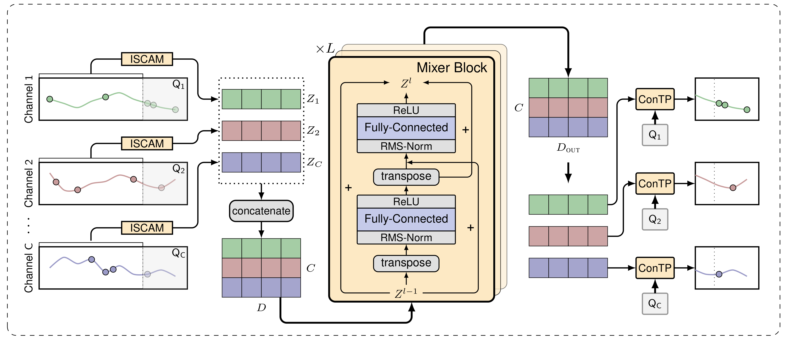
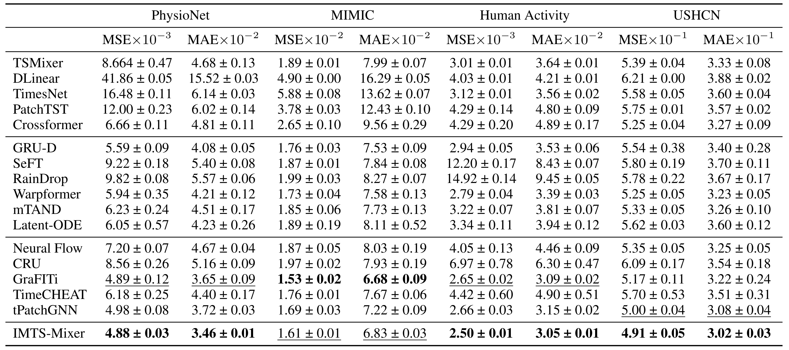

# IMTS-Mixer

Official implementation of the paper:  
**"IMTS-Mixer: Mixer Networks for Irregular Multivariate Time Series Forecasting"**, submitted to **AAAI 2026**.

<div align="center">
  
</div>

---

## 📊 Datasets

Our experiments follow the setup in [1], reusing the raw data and preprocessing code from the official [t-PatchGNN repository](https://github.com/usail-hkust/t-PatchGNN).

- **Included**:  
  - `Activity` and `USHCN` datasets (bundled with this repository)  
  - `PhysioNet`: Automatically downloaded and preprocessed on first run

- **Not included**:  
  - `MIMIC`: Licensed under the PhysioNet Credentialed Health Data License.
  However, there is a preprocessed version of the dataset available here:
  https://physionet.org/content/mimic-iii-ext-tpatchgnn/1.0.0/ (available only for credentialed PhysioNet users.)

---

## 🛠️ Installation & Requirements

We recommend setting up a fresh Conda environment (Python 3.11):

```bash
conda create -n imtsmixer python=3.11
conda activate imtsmixer
pip install -r requirements.txt
```

## 🚀 Reproducing Results
To reproduce the results on various datasets, use the following commands and add --seed  {0,1,2,3,4}:

<div align="center">  </div>

```bash
# PhysioNet
python run_imts_mixer_pmau.py --D 64 --D_dec 128 --mixer-blocks 2 --w_decay 0.01 --lr 0.01 --patience 20 --dataset physionet --history 24 -b 32

# MIMIC
python run_imts_mixer_pmau.py --D 64 --D_dec 128 --mixer-blocks 3 --w_decay 0.001 --lr 0.01 --patience 20 --dataset mimic --history 24 -b 32

# Human Activity
python run_imts_mixer_pmau.py --D 64 --D_dec 128 --mixer-blocks 2 --w_decay 0.0001 --lr 0.01 --patience 20 --dataset activity --history 3000 -b 32

# USHCN
python run_imts_mixer_pmau.py --D 64 --D_dec 128 --mixer-blocks 2 --w_decay 0.0001 --lr 0.01 --patience 20 --dataset ushcn --history 24 -b 32
```

## Physiome-ODE

To run IMTS-Mixer on the Physiome-ODE[2] datasets you first have to obtain the Physiome-ODE datasets from zenodo: https://zenodo.org/records/11492058
Detailed descriptions on how to recreate the datasets from scratch are given here: https://github.com/kloetergensc/Physiome-ODE.
We give an example on how to run IMTS mixer on one of the datasets (borghans_dupont_goldbeter_1997a):

```bash
python run_imts_mixer_physiomeode.py --dataset borghans_dupont_goldbeter_1997a --fold 0
```

## 📚 Reference
[1] Zhang, W., Yin, C., Liu, H., Zhou, X., & Xiong, H. (2024).
Irregular Multivariate Time Series Forecasting: A Transformable Patching Graph Neural Networks Approach.
In Forty-First International Conference on Machine Learning (ICML 2024).

[2]Klötergens, C.; Yalavarthi, V. K.; Scholz, R.; Stubbemann, M.; Born, S.; and Schmidt-Thieme, L. 2024. 
Physiome-ODE: A Benchmark for Irregularly Sampled Multivariate Time-Series Forecasting Based on Biological ODEs.
In The Thirteenth International Conference on Learning Representations.